# PrintGo — System Diagrams & Documentation

> Stack: React + TypeScript · Node.js / Express + WebSocket · MongoDB Atlas · PostgreSQL (Prisma) · AWS S3

---

## Table of Contents

1. [System Overview](#1-system-overview)
2. [Architecture Diagram](#2-architecture-diagram)
3. [Data Flow Diagram — Level 0 (Context)](#3-data-flow-diagram--level-0-context)
4. [Data Flow Diagram — Level 1 (User Print Flow)](#4-data-flow-diagram--level-1-user-print-flow)
5. [Data Flow Diagram — Level 1 (Admin Flow)](#5-data-flow-diagram--level-1-admin-flow)
6. [Print Job State Machine](#6-print-job-state-machine)
7. [ER Diagram](#7-er-diagram)
8. [UML Class Diagram — Server](#8-uml-class-diagram--server)
9. [UML Class Diagram — Frontend](#9-uml-class-diagram--frontend)
10. [Sequence Diagram — User Print Flow](#10-sequence-diagram--user-print-flow)
11. [Sequence Diagram — Admin Kiosk Management](#11-sequence-diagram--admin-kiosk-management)
12. [REST API Endpoints](#12-rest-api-endpoints)
13. [WebSocket Events Reference](#13-websocket-events-reference)

---

## 1. System Overview

| Actor | Role |
|---|---|
| **User** | Scans QR code on kiosk, uploads PDF from phone, pays, collects printout |
| **Kiosk App** | Electron/web app on the physical machine — displays QR, receives files, prints |
| **Agent** | Node.js daemon on kiosk machine — manages OS, PM2, printers, PTY terminal |
| **Admin** | Dashboard user — manages kiosks, printers, accounts via WebSocket |
| **Server** | Central Express + WebSocket hub orchestrating all actors |

| Layer | Technology |
|---|---|
| Frontend | React 18, TypeScript, Vite, TailwindCSS, shadcn/ui, React Router v6 |
| Backend | Node.js, Express.js, `ws` WebSocket, node-cron |
| Primary DB | MongoDB Atlas (Mongoose) — Kiosk & Admin records |
| Transaction DB | PostgreSQL via Prisma — anonymous print sessions |
| File Storage | AWS S3 — signed URLs for direct browser upload / kiosk download |
| Auth (User) | JWT 10 min — issued after QR scan |
| Auth (Admin) | JWT 30 min + Google OAuth for regular users |

---

## 2. Architecture Diagram

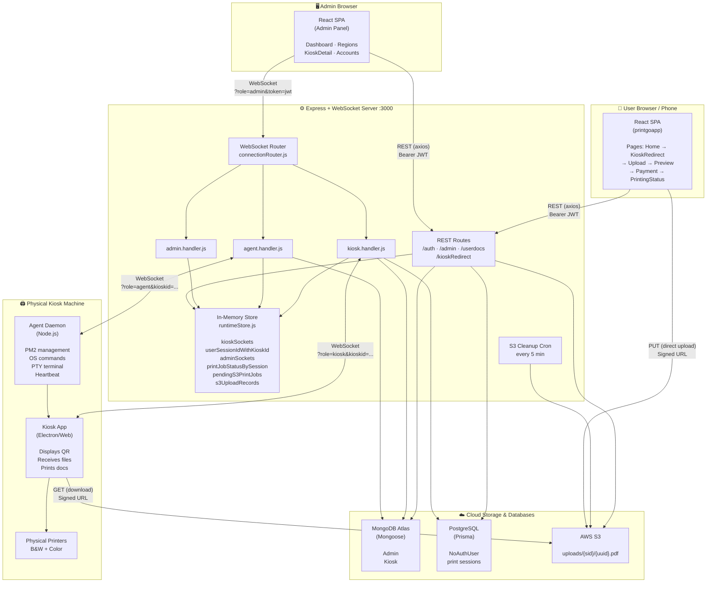

---

## 3. Data Flow Diagram — Level 0 (Context)

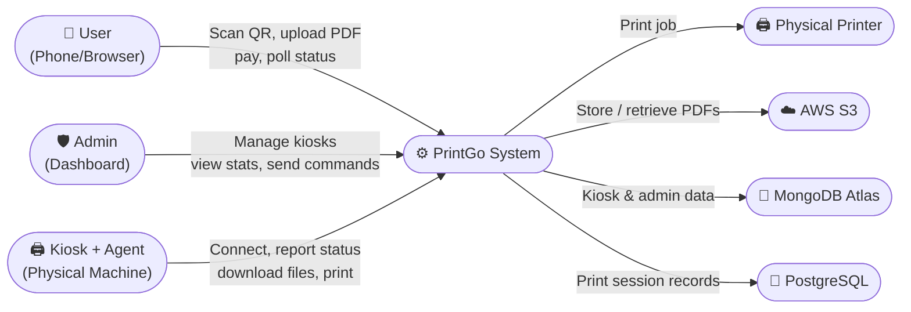

---

## 4. Data Flow Diagram — Level 1 (User Print Flow)

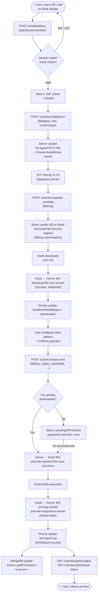

---

## 5. Data Flow Diagram — Level 1 (Admin Flow)

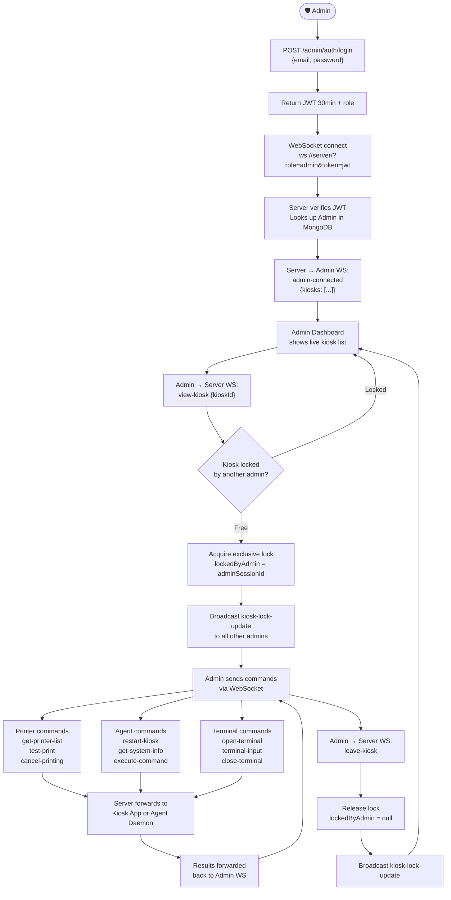

---

## 6. Print Job State Machine

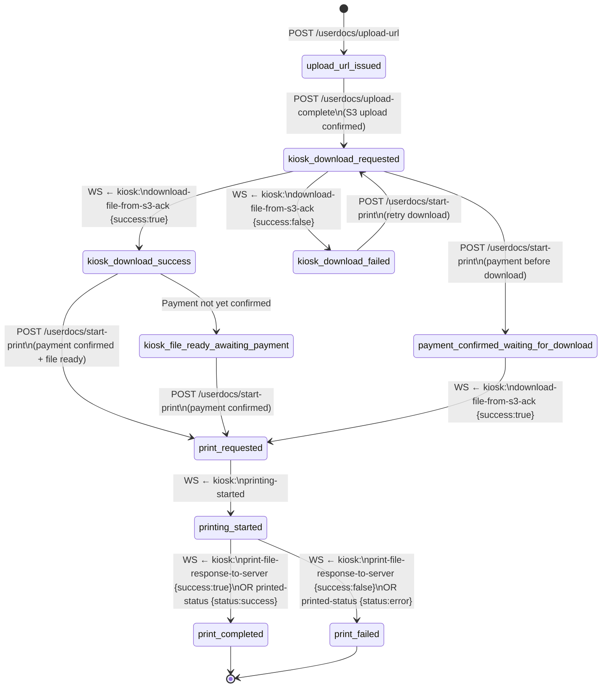

---

## 7. ER Diagram

```mermaid
erDiagram
    ADMIN {
        ObjectId _id PK
        string username UK
        string email UK
        string password
        string role "superadmin | service_person"
        boolean isActive
        datetime createdAt
        datetime updatedAt
    }

    KIOSK {
        ObjectId _id PK
        string kioskId UK
        string kioskName
        boolean isActive
        boolean newConnection
        string currentOwner
        string location_region
        string location_city
        string location_address
        string location_pincode
        float location_lat
        float location_lng
        string bw_printer_name
        string bw_printer_status
        float bw_pricePerPage
        string color_printer_name
        string color_printer_status
        float color_pricePerPage
        string machineDetails_hostname
        string machineDetails_platform
        string machineDetails_status "online|offline|maintenance"
        datetime machineDetails_lastSeenAt
        int metrics_totalPrintJobs
        float metrics_revenue_total
        float metrics_revenue_monthly
        float metrics_revenue_daily
        int config_maxFileSizeMB
        datetime createdAt
        datetime updatedAt
    }

    NOAUTHUSER {
        uuid id PK
        string userSessionNumber
        string kioskId FK
        string fileName
        string s3UploadStatus "pending|uploaded|failed"
        string kioskDownloadStatus "pending|requested|downloaded|failed"
        json fileConfig
        string paymentStatus "pending|success|failed|refunded"
        string transactionId UK
        float paymentAmount
        string paymentMethod
        datetime paymentTimestamp
        string merchantOrderId
        string payerVpa
        string printStatus "pending|printing|success|failed"
        boolean isPrintStarted
        boolean isPrinted
        datetime printedAt
        datetime createdAt
        datetime updatedAt
    }

    S3_FILE {
        string fileKey PK "uploads/{sessionId}/{uuid}.pdf"
        string sessionId FK
        string kioskId FK
        string fileName
        string contentType
        int size
        string status "url-issued|uploaded|printing"
        datetime createdAt
        datetime uploadedAt
    }

    ADMIN ||--o{ KIOSK : "manages"
    KIOSK ||--o{ NOAUTHUSER : "hosts sessions"
    NOAUTHUSER ||--|| S3_FILE : "has one file"
```

---

## 8. UML Class Diagram — Server

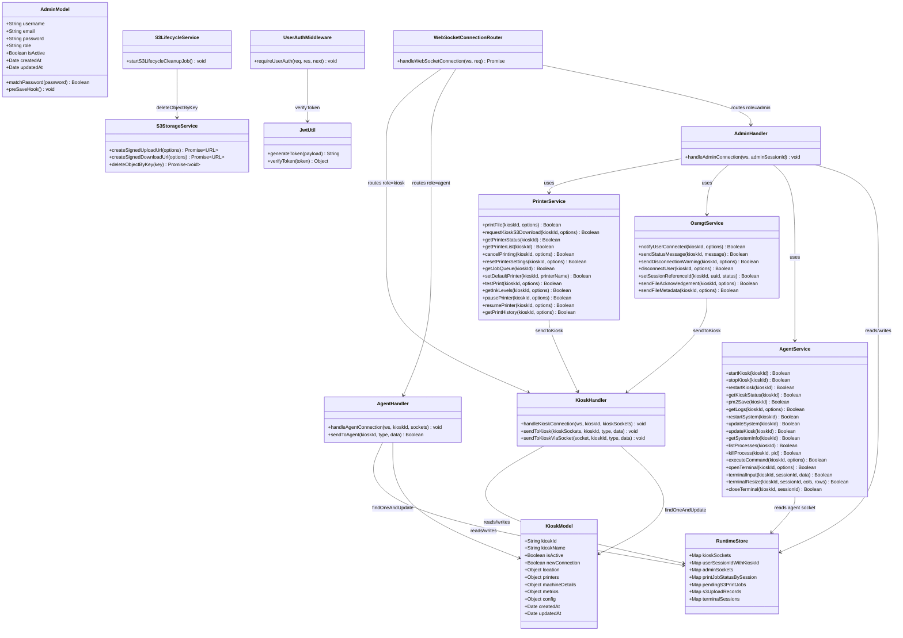

---

## 9. UML Class Diagram — Frontend

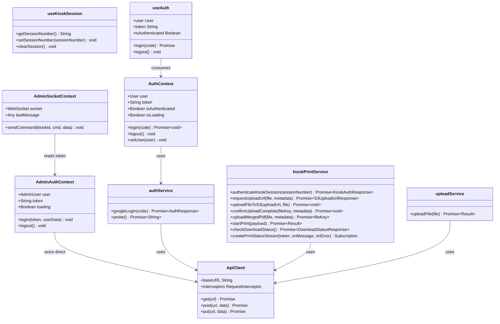

---

## 10. Sequence Diagram — User Print Flow

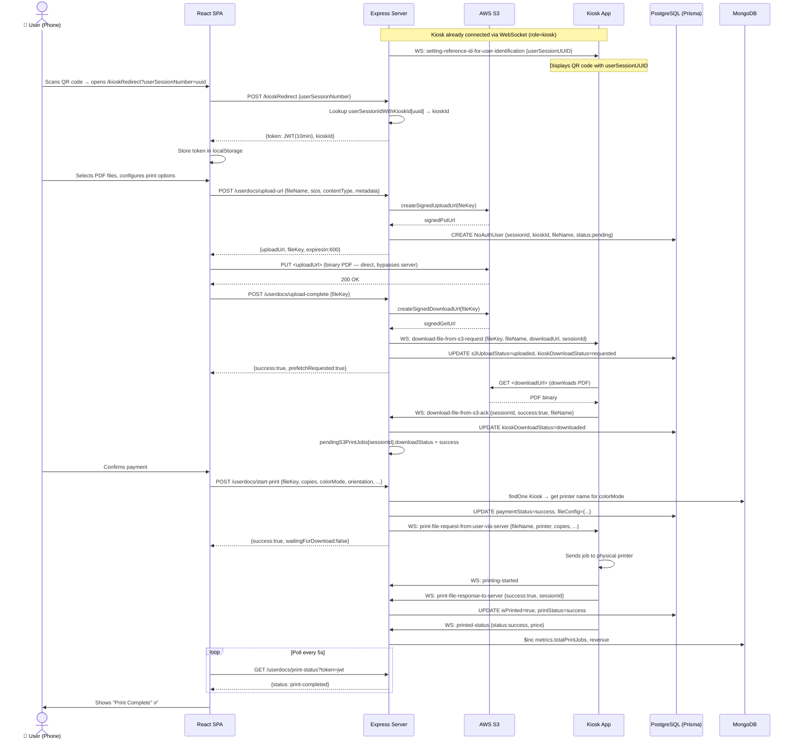

---

## 11. Sequence Diagram — Admin Kiosk Management

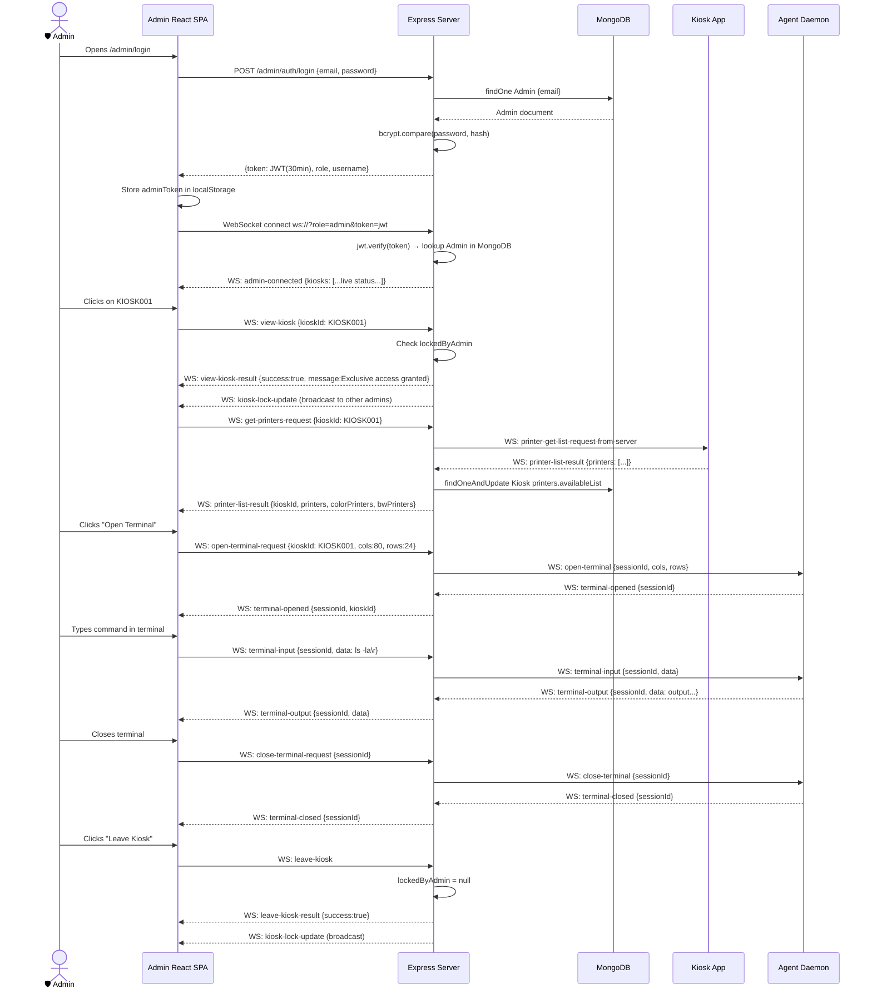

---

## 12. REST API Endpoints

### Auth — `/auth`

| Method | Path | Auth | Description |
|--------|------|------|-------------|
| `POST` | `/auth/google` | None | Exchange Google OAuth code → app JWT + user profile |
| `GET` | `/auth/pr` | None | Health-check probe |

### Admin Auth — `/admin/auth`

| Method | Path | Auth | Description |
|--------|------|------|-------------|
| `POST` | `/admin/auth/register` | None | Register admin (first = superadmin, auto-activated) |
| `POST` | `/admin/auth/login` | None | Login → JWT 30min |
| `POST` | `/admin/auth/logout` | None | Logout (client-side) |
| `GET` | `/admin/auth/me` | Bearer JWT | Get current admin profile |

### Admin Management — `/admin`

| Method | Path | Auth | Description |
|--------|------|------|-------------|
| `GET` | `/admin/accounts` | Bearer + superadmin | List all admin accounts |
| `PATCH` | `/admin/accounts/:id` | Bearer + superadmin | Update admin `isActive` / `role` |
| `GET` | `/admin/kiosks` | Bearer | List all kiosks (DB + live socket status merged) |
| `GET` | `/admin/kiosks/:kioskId` | Bearer | Get single kiosk details |
| `PATCH` | `/admin/kiosks/:kioskId` | Bearer | Update kiosk fields in MongoDB |
| `POST` | `/admin/kiosks/:kioskId/:command` | Bearer | Send command to kiosk (stub) |

### User / Session — `/`

| Method | Path | Auth | Description |
|--------|------|------|-------------|
| `POST` | `/kioskRedirect` | None | Validate QR session UUID → return user JWT 10min |
| `POST` | `/kisokRedirect` | None | Alias (typo kept for compatibility) |

### Upload & Print — `/userdocs`

| Method | Path | Auth | Description |
|--------|------|------|-------------|
| `POST` | `/userdocs/upload-url` | Bearer (user) | Generate S3 signed PUT URL + create Prisma record |
| `POST` | `/userdocs/upload-complete` | Bearer (user) | Confirm S3 upload + trigger kiosk pre-download |
| `POST` | `/userdocs/start-print` | Bearer (user) | Confirm payment + dispatch print to kiosk |
| `GET` | `/userdocs/print-status` | Bearer or `?token=` | Poll in-memory print job status |
| `GET` | `/userdocs/download-status` | Bearer (user) | Check kiosk download status from Prisma |

---

## 13. WebSocket Events Reference

### 13.1 Server → Kiosk

| Event | Key Payload Fields | Purpose |
|---|---|---|
| `setting-reference-id-for-user-identification` | `userSessionUUID, serverStatus` | Push session UUID for QR code generation |
| `connected-to-user-successfully` | `userName` | User scanned QR and connected |
| `status-user-connected-to-kiosk` | `msg` | General status message for kiosk UI |
| `user-disconnection-warning` | `msg, isActive, timeout_period` | Countdown warning before user disconnect |
| `user-disconnected` | `reason` | User session ended — reset kiosk UI |
| `download-file-from-s3-request` | `fileKey, fileName, downloadUrl, sessionId` | Ask kiosk to download PDF from S3 |
| `print-file-request-from-user-via-server` | `fileName, sessionId, copies, printer, orientation, paperSize, sides, pageRanges, fitToPage, colorMode` | Dispatch print job |
| `metadata-before-file-sending` | `userName, fileName, fileSize, totalChunks, sessionId` | File metadata before binary chunks (legacy) |
| `ack-after-file-sent` | `fileName, sessionId, kioskId` | Confirm file transfer complete (legacy) |
| `printer-status-request-from-server` | — | Request printer status |
| `printer-get-list-request-from-server` | — | Request printer list |
| `cancle-printing-request-from-server` | `printer` | Cancel active print job |
| `reset-printer-settings-from-server` | `printer` | Reset printer settings |
| `get-job-queue-request-from-server` | — | Request print job queue |
| `set-default-printer-request-from-server` | `printerName` | Set default printer |
| `test-print-request-from-server` | `printer` | Send test print |
| `ink-levels-request-from-server` | `printer` | Request ink/toner levels |
| `pause-printer-request-from-server` | `printer, reason` | Pause printer |
| `resume-printer-request-from-server` | `printer` | Resume printer |
| `print-history-request-from-server` | `limit` | Request print history |
| `restart-kiosk-now` | `msg` | Sent to agent when kiosk disconnects |

### 13.2 Kiosk → Server

| Event | Key Payload Fields | Purpose |
|---|---|---|
| `register-kiosk` | `kioskid` | Kiosk registers on connect |
| `reset-user-session-id-kiosk` | `oldId` | Request new session UUID (user left) |
| `download-file-from-s3-ack` | `sessionId, success, fileKey, fileName, error` | S3 download result |
| `printing-started` | `status, data` | Print job started |
| `print-file-response-to-server` | `sessionId, success` | Print job result |
| `printed-status` | `status, data.price` | Final print status — triggers metrics update on success |
| `printer-list-result` | `data.printers[]` | Available printers — updates MongoDB |
| `printer-get-list-response-to-server` | `printers[]` | Alias for above |
| `kiosk-status-result` | `printers[]` | Full kiosk status |
| `printer-status-response-to-server` | `data` | Printer status report |
| `ack-of-file-from-kiosk` | `sessionId` | File received (legacy direct transfer) |
| `unique-user-id-setuped` | `kioskStatus, kioskid, userUniqueReferenceId` | Session UUID confirmed |
| `job-status` | `...` | General job status |
| `testing-file-request-from-kiosk` | `sessionId` | Request test file send |

### 13.3 Server → Agent

| Event | Key Payload Fields | Purpose |
|---|---|---|
| `start-kiosk-now` | — | Start kiosk app via PM2 |
| `stop-kiosk-now` | — | Stop kiosk app via PM2 |
| `restart-kiosk-now` | — | Restart kiosk app via PM2 |
| `kiosk-status-check` | — | Get PM2 kiosk process status |
| `pm2-save` | — | Persist PM2 process list |
| `get-logs` | `lines` | Fetch PM2 logs |
| `restart-system-now` | — | Reboot kiosk machine |
| `update-system-now` | — | Run apt-get update + upgrade |
| `update-kiosk-now` | — | git pull + npm install + pm2 restart |
| `get-system-info` | — | CPU, memory, disk, temp, IPs |
| `list-processes` | — | List all PM2 processes |
| `kill-process` | `pid` | Kill a process by PID |
| `execute-command` | `cmd, cwd, timeout, requestId` | Execute arbitrary shell command |
| `open-terminal` | `sessionId, cols, rows` | Open PTY terminal session |
| `terminal-input` | `sessionId, data` | Send input to PTY |
| `terminal-resize` | `sessionId, cols, rows` | Resize PTY |
| `close-terminal` | `sessionId` | Close PTY session |

### 13.4 Agent → Server

| Event | Key Payload Fields | Purpose |
|---|---|---|
| `agent-ready` | `kioskName, hostname, platform, arch, capabilities` | Agent connected — updates MongoDB machineDetails |
| `agent-heartbeat` | `timestamp, freeMemory, uptime, loadAvg` | Periodic heartbeat — updates MongoDB lastSeenAt |
| `kiosk-command-result` | `command, success` | Result of kiosk management command |
| `kiosk-status-result` | `success, printers[]` | Kiosk status — updates MongoDB printers |
| `printer-list-result` | `printers[]` | Printer list — updates MongoDB |
| `system-info-result` | `platform, arch, hostname` | System info — updates MongoDB machineDetails |
| `process-list-result` | `processes[]` | PM2 process list |
| `logs-result` | `logs[]` | PM2 log output |
| `execute-command-result` | `success, stdout, stderr, requestId` | Shell command result |
| `terminal-opened` | `sessionId` | PTY session ready |
| `terminal-output` | `sessionId, data` | PTY output (forwarded to admin) |
| `terminal-closed` | `sessionId` | PTY session closed |
| `terminal-error` | `sessionId, error` | PTY error |

### 13.5 Admin → Server

| Event | Key Payload Fields | Purpose |
|---|---|---|
| `get-kiosk-list` | — | Get all kiosks with live status |
| `view-kiosk` | `kioskId` | Acquire exclusive lock on kiosk |
| `leave-kiosk` | — | Release kiosk lock |
| `get-kiosk-data` | `kioskId` | Fetch kiosk from MongoDB |
| `update-kiosk-data` | `kioskId, data{}` | Update kiosk fields in MongoDB |
| `print-file` | `kioskId, fileName, sessionId, copies, printer, ...` | Dispatch print job |
| `get-printer-list` / `get-printers-request` | `kioskId` | Request printer list |
| `get-printer-status` | `kioskId` | Request printer status |
| `cancel-printing` | `kioskId, printer` | Cancel print job |
| `reset-printer-settings` | `kioskId, printer` | Reset printer settings |
| `get-job-queue` | `kioskId` | Get print job queue |
| `set-default-printer` | `kioskId, printerName` | Set default printer |
| `test-print` / `test-print-request` | `kioskId, printer` | Send test print |
| `get-ink-levels` | `kioskId, printer` | Get ink/toner levels |
| `pause-printer` | `kioskId, printer, reason` | Pause printer |
| `resume-printer` | `kioskId, printer` | Resume printer |
| `get-print-history` | `kioskId, limit` | Get print history |
| `notify-user-connected` | `kioskId, userName` | Notify kiosk of user |
| `send-status-message` | `kioskId, message` | Push status to kiosk UI |
| `send-disconnection-warning` | `kioskId, message, timeoutPeriod` | Warn kiosk of disconnect |
| `disconnect-user` | `kioskId, reason` | Disconnect user from kiosk |
| `set-session-reference-id` | `kioskId, userSessionUUID` | Push new session UUID to kiosk |
| `start-kiosk` / `start-kiosk-request` | `kioskId` | Start kiosk via PM2 |
| `stop-kiosk` / `stop-kiosk-request` | `kioskId` | Stop kiosk via PM2 |
| `restart-kiosk` / `restart-kiosk-request` | `kioskId` | Restart kiosk via PM2 |
| `get-kiosk-status` / `get-kiosk-status-request` | `kioskId` | Get PM2 status |
| `pm2-save` | `kioskId` | Save PM2 process list |
| `get-logs` / `get-logs-request` | `kioskId, lines` | Fetch PM2 logs |
| `restart-system` | `kioskId` | Reboot kiosk machine |
| `update-system` | `kioskId` | Run system update |
| `update-kiosk` | `kioskId` | Update kiosk app |
| `get-system-info` / `get-system-info-request` | `kioskId` | Get system info |
| `list-processes` | `kioskId` | List PM2 processes |
| `kill-process` | `kioskId, pid` | Kill a process |
| `execute-command` | `kioskId, cmd, cwd, timeout` | Execute shell command |
| `open-terminal` / `open-terminal-request` | `kioskId, sessionId, cols, rows` | Open PTY terminal |
| `terminal-input` | `sessionId, data` | Send input to terminal |
| `terminal-resize` | `sessionId, cols, rows` | Resize terminal |
| `close-terminal` / `close-terminal-request` | `sessionId` | Close terminal |

### 13.6 Server → Admin (Responses & Broadcasts)

| Event | Purpose |
|---|---|
| `admin-connected` | Sent on connect with live kiosk list |
| `kiosk-list` | Response to `get-kiosk-list` |
| `kiosk-lock-update` | Broadcast when any kiosk lock changes |
| `view-kiosk-result` | Result of view-kiosk request |
| `leave-kiosk-result` | Result of leave-kiosk request |
| `update-kiosk-data-result` | Result of kiosk DB update |
| `get-kiosk-data-result` | Kiosk data from MongoDB |
| `agent-ready` | Forwarded from agent |
| `agent-heartbeat` | Forwarded from agent |
| `agent-disconnected` | Agent went offline |
| `printer-list-result` | Forwarded from kiosk/agent (with colorPrinters, bwPrinters categorized) |
| `kiosk-status-result` | Forwarded from agent/kiosk |
| `system-info-result` | Forwarded from agent |
| `process-list-result` | Forwarded from agent |
| `logs-result` | Forwarded from agent |
| `execute-command-result` | Forwarded from agent |
| `terminal-opening` | Terminal session being opened |
| `terminal-opened` | Terminal session ready |
| `terminal-output` | PTY output stream |
| `terminal-closed` | Terminal session closed |
| `terminal-error` | Terminal error |
| `printed-status` | Forwarded from kiosk |
| `download-file-from-s3-ack` | Forwarded from kiosk |
| `print-file-result` | Ack that print command was dispatched |
| `start/stop/restart-kiosk-result` | Ack for kiosk management commands |
| `error` | Error response |

---

## 14. Frontend Route Map

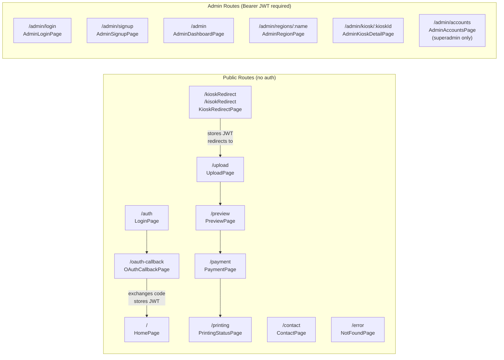
